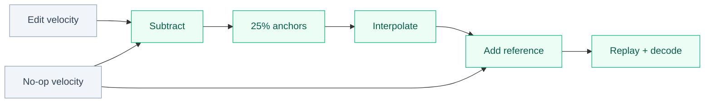

<div align="center">

# SpillCache

### Deviation-space reconstruction for diffusion-transformer image editing

**Guandong Li** · **Mengxia Ye**  
iFLYTEK · Aegon THTF

  

[Method](#method) · [Results](#results) · [Quick start](#quick-start) · [GPU reproduction](#gpu-reproduction) · [Repository guide](#repository-guide)

</div>

---

SpillCache studies a simple choice in selective token computation: **which velocity field should we reconstruct from sparse image-token samples?** We compare absolute edit velocities with edit–no-op deviations, using the same spatial anchors and the same interpolation operator.

On a 24-example pilot, deviation reconstruction achieves **76.5% lower LPIPS** and **+11.74 dB PSNR** relative to absolute interpolation, measured against dense replay at **25% active-token density**.

> **Evaluation protocol:** results come from captured dense-trajectory replay. Velocities are captured in advance and are not reevaluated at the replayed latent states. Closed-loop sparse inference and end-to-end speedup remain unverified.

## Method

The no-op reference captures how the source image evolves under an unchanged-image instruction. SpillCache reconstructs the paired-step edit–reference difference and adds the reference velocity back.



For a fixed active set and interpolation operator $R_{\mathcal A}$:

$$
\widehat v_s^{\mathrm{abs}} = R_{\mathcal A}v_s^e,
\qquad
\widehat v_s^{\mathrm{dev}} = v_s^r + R_{\mathcal A}(v_s^e-v_s^r).
$$

The edit and no-op runs follow separate latent trajectories and are aligned by scheduler index. Both reconstructions use nearest-neighbor gathering and Gaussian smoothing. Holding the active set and operator fixed isolates the representation being interpolated.

## Results

**Qwen-Image-Edit-2511 · 24 examples · 1,024 of 4,096 generated-image tokens retained**

| Reconstruction | LPIPS ↓ | PSNR ↑ | SSIM ↑ |
| :--- | ---: | ---: | ---: |
| Absolute velocity | 0.7719 | 12.09 dB | 0.207 |
| **Edit–no-op deviation** | **0.1817** | **23.83 dB** | **0.832** |
| Change | **−76.5%** | **+11.74 dB** | **+0.625** |

Deviation reconstruction gives lower LPIPS on **24 / 24 examples**. All metrics measure agreement with dense replay, rather than semantic editing quality against a human target.

| Protocol | Setting |
| :--- | :--- |
| Data | Manually selected ImgEdit-Bench pilot: 8 add, 4 attribute, 4 remove, 8 replace |
| Resolution | 1024 × 1024 |
| Sampling | Regular spatial grid, $K=0.25$ |
| Inference configuration | 28 steps · true CFG 4.0 · seed 42 |
| Final step | Dense |

Per-example records are included in [results/quality](results/quality) and [results/fidelity](results/fidelity). Sample IDs and instructions are in the [pilot manifest](data/pilot_manifest.jsonl). The pilot is a manually selected subset, not an official benchmark split.

## Quick start

**Reproduce the aggregate tables on CPU.** These commands use only the Python standard library; no model download or GPU is needed.

```bash
git clone https://github.com/leeguandong/SpillCache.git
cd SpillCache

# Decoded-image fidelity: LPIPS, PSNR, SSIM, win rate and bootstrap interval.
python scripts/summarize_lift_quality.py \
  --root results/quality \
  --output quality_summary.json

# Velocity reconstruction: exclude the final step, matching steps 0–26 in the paper.
python scripts/summarize_lifting_fidelity.py \
  --root results/fidelity \
  --exclude-last-step \
  --output fidelity_summary.json
```

Use the **`checkerboard`** row for the regular-grid comparison above. The **`edit`** rows use oracle magnitude selection from captured dense trajectories and do not evaluate an online selector.

## GPU reproduction

<details>
<summary><strong>Capture trajectories and replay a single example</strong></summary>

### 1. Prepare the model and source image

- Obtain **Qwen-Image-Edit-2511** and a compatible diffusers checkout providing `QwenImageEditPlusPipeline`.
- Obtain the source images from the original [ImgEdit-Bench release](https://github.com/PKU-YuanGroup/ImgEdit).
- Place images at the paths in [data/pilot_manifest.jsonl](data/pilot_manifest.jsonl), or update the manifest to your local paths.

The original runs recorded diffusers commit `97c2c6e3971243a081dc879496166fc8848baca5`. Models, source images and third-party source code are not bundled in this repository.

### 2. Set up the environment

```bash
python -m pip install -r requirements-gpu.txt

export SPILLCACHE_MODEL_PATH=/path/to/Qwen-Image-Edit-2511
export SPILLCACHE_DIFFUSERS_PATH=/path/to/diffusers
```

### 3. Capture and compare velocities

```bash
python -m scripts.run_lifting_fidelity \
  --sample-id att_065 \
  --budgets 0.25 \
  --output outputs/lifting_fidelity/att_065
```

### 4. Replay and evaluate decoded images

```bash
python -m scripts.run_endtoend_lift_quality \
  --sample-id att_065 \
  --budgets 0.25 \
  --dense-only-last 1 \
  --output outputs/lift_quality/att_065
```

The historical filename `run_endtoend_lift_quality.py` refers to decoding the final replay latent into an image. The script uses captured dense velocities throughout; it does not execute a closed-loop sparse transformer.

The stored aggregates have been reproduced on CPU for this artifact. GPU capture was not rerun during packaging.

</details>

## Repository guide

```text
SpillCache/
├── data/
│   └── pilot_manifest.jsonl          # 24 sample IDs, instructions and image paths
├── results/
│   ├── quality/                     # Per-example decoded-image metrics
│   └── fidelity/                    # Per-step velocity reconstruction metrics
├── scripts/
│   ├── run_lifting_fidelity.py       # Dense trajectory capture and reconstruction
│   ├── run_endtoend_lift_quality.py  # Image-level trajectory replay
│   ├── summarize_lift_quality.py    # Image metric aggregation
│   └── summarize_lifting_fidelity.py
├── spillcache/fidelity.py            # PSNR, SSIM and LPIPS evaluation
├── requirements-gpu.txt
└── PROVENANCE.json                   # Original source hashes and artifact scope
```

## Scope and provenance

This release contains the controlled reconstruction experiment and its numeric records. Relation-aware selection, GraphLifter and the sparse execution backend are outside the evaluated artifact. The results use one model, one seed, one active-token density and a small manually selected pilot.

Scientific interpolation and replay functions are preserved from the research snapshot. Packaging changes cover explanatory docstrings, portable paths and the default budget. See [PROVENANCE.json](PROVENANCE.json) for the original source hashes.

Third-party benchmarks, models and libraries retain their own licenses. This snapshot does not add a software license grant.
